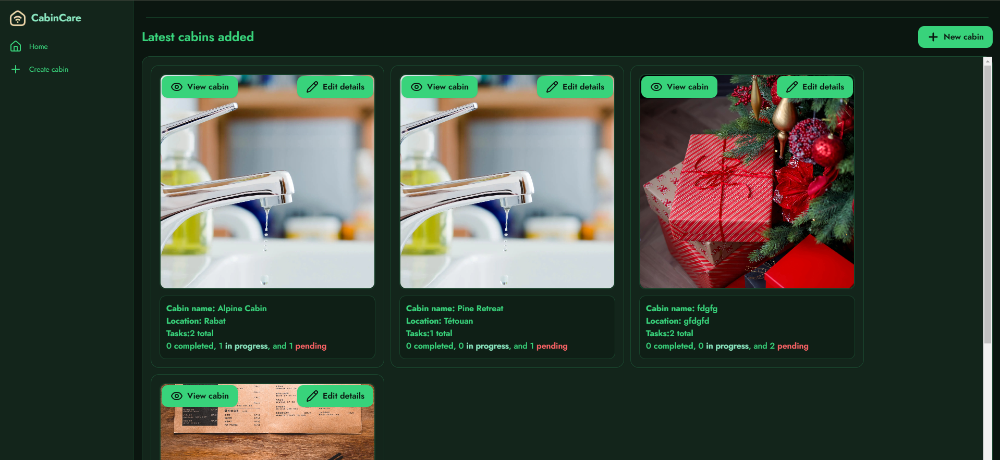

# CabinCare

<p align="center">
  
</p>

CabinCare is a full-stack application for managing cabins and logging their maintenance: register cabins, track tasks with priority/status workflows, and get an analytics dashboard summarizing maintenance activity. Frontend is Next.js; backend is NestJS with PostgreSQL — all runnable via a single script.

## ✨ Features

- **Cabin management** — create, browse, and update cabins, each with a photo upload
- **Task workflows** — log maintenance tasks with priority & status (todo → in progress → done)
- **Analytics dashboard** — summarize maintenance activity at a glance
- **One-command setup** — `setup.sh` bootstraps the database, backend, and frontend

## 🧱 Architecture

```
┌────────────────────┐       ┌─────────────────────┐       ┌────────────┐
│   Next.js frontend │  HTTP │      NestJS API     │ SQL    │ PostgreSQL │
│    (port 3000)     │ ────▶ │     (port 3001)     │ ─────▶ │  (Docker)  │
└────────────────────┘       │  cabins · tasks     │        └────────────┘
                             │  image uploads      │
                             └─────────────────────┘
```

**Stack:** Next.js (App Router) · NestJS · PostgreSQL · Docker · TypeScript

## 🚀 Quick start

```bash
./setup.sh
docker compose up --build
# frontend → http://localhost:3000
# backend  → http://localhost:3001
```

## 🔌 API

| Method | Endpoint | Description |
|---|---|---|
| `POST` | `/cabins` | Create a cabin (multipart: `name`, `location`, `image?`) |
| `GET` | `/cabins` | List cabins |
| `GET` | `/cabins/:id` | Get a cabin by id |
| `PUT` | `/cabins/:id` | Update a cabin (multipart optional image) |
| `POST` | `/tasks` | Create a task (`description`, `priority`, `status`, `cabin_id`) |
| `GET` | `/tasks/:id` | List tasks for a cabin |
| `PUT` | `/tasks/:id` | Update a task's status |

## 🛠️ Design decisions

- Tasks are fetched per-cabin via `GET /tasks/:id` to keep dashboard queries scoped and simple (no aggregate join needed for the main view).
- Cabin create/update accepts multipart uploads so images can be stored on disk quickly without adding object storage complexity.
